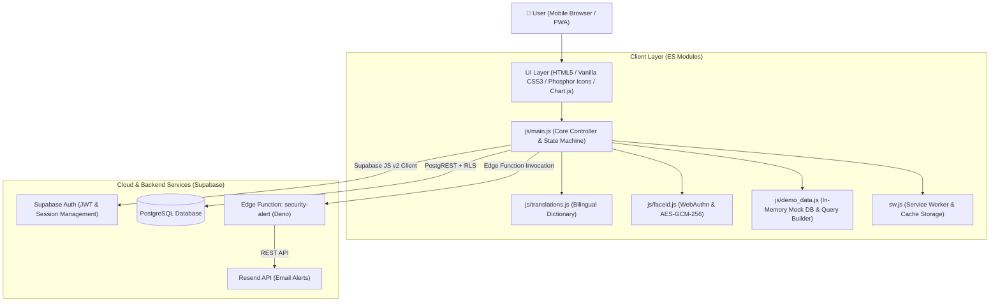
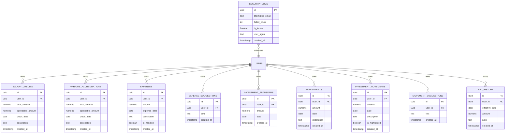
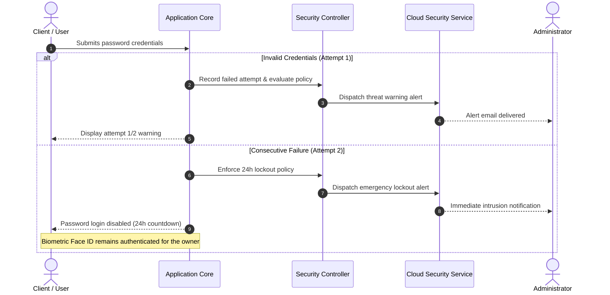

# Finance Management — System Architecture & Technical Documentation

> **Document Version:** 1.0.0  
> **Target Audience:** Large Language Models (LLMs), AI Agents, and Software Engineers.  
> **Application Type:** Progressive Web Application (PWA) / Single Page Application (SPA).  
> **Author & Owner:** Vito Ditrani  
> **Deployment Target:** GitHub Pages (`https://vito3136.github.io/Finance_Management/`).  
> **Backend Infrastructure:** Supabase (PostgreSQL, Auth, Row Level Security, Edge Functions with Deno & Resend API).

---

## 1. Executive Summary & Product Vision

**Finance Management** is a high-performance, mobile-first Progressive Web Application designed with native iOS look-and-feel (Apple Human Interface Guidelines). The application serves as a unified financial hub providing:

1. **Gestione Spese (Expense Management Mode):** Tracking salary credits, supplementary incomes, day-to-day categorized expenses, automated FIFO budget allocation (handled vs. unhandled expenses), cumulative savings tracking, and historical career salary growth (RAL - *Retribuzione Annua Lorda*).
2. **Gestione Investimenti (Investment Management Mode):** Tracking incoming bank transfers to brokerage/investment accounts, asset allocations (ETFs, stocks, funds), portfolio movements (fees, dividends, interest), highlighted yield metrics, and available liquidity.
3. **Advanced Biometric Security:** Native Apple Face ID / Touch ID login powered by the WebAuthn Platform Authenticator combined with Web Crypto AES-GCM-256 local encrypted credential vaults.
4. **Active Threat Mitigation:** Real-time 24-hour lockout mechanism on brute-force attempts and automated security alert dispatching to the owner via Supabase Edge Functions and the Resend API.
5. **Full Offline & Demo Simulation:** Complete in-memory mock database with an embedded query builder replicating Supabase behavior for zero-backend offline evaluation.
6. **Bilingual Internationalization (i18n):** Real-time client-side switching between Italian (`it`) and English (`en`).

---

## 2. High-Level System Architecture



---

## 3. Repository File Structure & Module Directory

```
Finance_Management/
├── index.html                           # Single-page DOM structure, view containers, modals, SVG icons
├── manifest.json                        # PWA standalone manifest, icons, theme colors
├── sw.js                                # Service Worker: cache storage, network-first strategy, cache busting
├── icon.png                             # Application icon (192x192 & 512x512)
├── css/
│   └── style.css                        # Complete iOS Design System, Dark/Light modes, animations
├── js/
│   ├── main.js                          # Core application logic, event orchestrator, state management
│   ├── faceid.js                        # WebAuthn Face ID / Touch ID enrollment and AES-GCM crypto
│   ├── translations.js                  # Internationalization dictionary (Italian & English)
│   └── demo_data.js                     # Mock fixtures and in-memory Supabase Query Builder
└── supabase/
    ├── expense_suggestions.sql          # DDL & RLS policy for expense suggestions
    ├── movement_suggestions.sql         # DDL & RLS policy for investment movement suggestions
    ├── ral_history.sql                  # DDL & RLS policy for gross salary increases history
    ├── security_logs.sql                # DDL & RLS policy for intrusion/lockout tracking
    └── functions/
        └── security-alert/
            └── index.ts                 # Deno serverless edge function for security email alerts
```

---

## 4. Module Specifications & Responsibilities

### 4.1. `index.html`
- **Role:** Master document and declarative structure of all application views and dialogs.
- **Key Sections:**
  - **Splash Screen (`#splash-screen`):** Transient screen preventing flash of unauthenticated content.
  - **Login Screen (`#login-screen`):** Email/password credentials, Face ID quick-login button, privacy toggle, and demo mode trigger.
  - **Modals (`.custom-modal`):**
    - `#faceid-setup-modal`: Post-login prompt to activate hardware biometrics.
    - `#security-alert-modal`: Critical security intrusion warning display.
    - `#add-salary-modal`: Salary deposit form with monthly auto-suggestion chip.
    - `#add-various-modal`: Supplementary accreditation form.
    - `#add-expense-modal`: Expense entry form with dynamic chip suggestions.
    - `#add-bonifico-modal`: Bank transfer to investment portfolio form.
    - `#add-investimento-modal`: Investment purchase form with single last-used-asset chip.
    - `#add-movimento-modal`: Investment movements/fees/dividends form with custom chips.
    - `#suggestions-modal`: Expense suggestion manager (add/delete chips).
    - `#movement-suggestions-modal`: Movement suggestion manager (add/delete chips).
    - `#ral-modal`: Gross salary progression manager (add/delete RAL increments).
  - **Top Navigation Bar (`nav.top-bar`):** Hamburger menu trigger, dynamic view title (`#app-title`), and global mode switch button (`#toggle-mode-btn`).
  - **Side Drawer Menu (`#side-menu`):** View routing, language switch (IT/EN), privacy mode toggle, Face ID toggle, scoped suggestion managers, and logout.
  - **Main View Containers (`.mode-container`):**
    - `#home-container`: Expense dashboard (remaining spendable balance, action buttons, recent transactions).
    - `#salary-container`: Salary credit archives with edit/delete triggers.
    - `#various-container`: Supplementary income records.
    - `#expense-container`: Complete expense history with monthly filter selector.
    - `#statistics-container`: Financial statistics with segment toggle (Counters vs. Interactive Charts).
    - `#investment-container`: Investment portfolio dashboard (total transfers, invested sum, liquidity, highlights).
    - `#investment-transfers-container`: History of incoming transfers to the portfolio.
    - `#investments-container`: Holdings list.
    - `#investment-movements-container`: Movement and dividend transactions.

### 4.2. `css/style.css`
- **Design Philosophy:** Native Apple iOS aesthetic.
- **Theming & Color Palettes:**
  - Light mode: Surface `#ffffff`, background `#f0f2f5`, primary text `#1c1c1e`.
  - Dark mode (`prefers-color-scheme: dark`): Surface `#1c1c1e`, background `#000000`, primary text `#ffffff`.
  - Accent colors:
    - Expense / Primary: `#007aff` (iOS System Blue).
    - Salary / Positive Flow: `#61bb61` / `#34c759` (iOS System Green).
    - Investment / Assets: `#5856d6` (iOS Purple).
    - Movements / Transactions: `#FF9500` (iOS Orange).
    - Gross Salary / RAL: `#AF52DE` (iOS Magenta/Purple).
    - Danger / Critical: `#ff3b30` (iOS Red).
- **Responsive Architecture:** Mobile-constrained max-width (`480px` / `600px` for dialogs), dynamic safe-area insets (`env(safe-area-inset-top)` / `bottom`), CSS custom properties, and smooth touch-optimized transitions (`-webkit-tap-highlight-color: transparent`).

### 4.3. `js/main.js`
- **Role:** Central application controller, reactive state store, and database client wrapper.
- **Global Architecture Highlights:**
  - `state`: Monolithic reactive state tracking user sessions, current views, active filters, loaded lists, suggestion caches, and Chart.js instances.
  - `DOM`: Pre-cached dictionary of element references for high-speed DOM manipulation.
  - `VIEWS_CONFIG` & `GLOBAL_MODE_CONFIG`: Declarative routing registries mapping views to titles, containers, and mode contexts.
  - Supabase Transparent Proxy: Automatic routing of DB queries to `createDemoQueryBuilder` when `state.isDemo` is active.

### 4.4. `js/faceid.js`
- **Role:** Cryptographic WebAuthn wrapper for passwordless biometric authentication.
- **Protocol & Cryptography:**
  - Utilizes `navigator.credentials.create` with `authenticatorAttachment: "platform"` (Face ID, Touch ID, Windows Hello).
  - Uses `crypto.subtle` PBKDF2 (100,000 iterations of SHA-256) on the credential identifier to derive an encryption key.
  - Encrypts the user's Supabase credentials locally using AES-GCM (256-bit key, 96-bit random IV, 128-bit random salt).
  - Stores only the ciphertext and public credential ID in `localStorage`.
  - Upon authentication, hardware biometrics unlocks the WebAuthn assertion, which is then used to decrypt credentials and sign in to Supabase silently.

### 4.5. `js/demo_data.js`
- **Role:** Complete mock environment allowing fully functional local testing without network connectivity or a Supabase backend.
- **Features:**
  - `getInitialDemoData()`: Generates dynamic dates relative to current month/year for realistic charts.
  - `createDemoQueryBuilder(getStore, table)`: Implements a fluent Promise-based builder supporting `.select()`, `.insert()`, `.update()`, `.delete()`, `.eq()`, `.order()`, and `.limit()`.

### 4.6. `js/translations.js`
- **Role:** Fully isolated dictionary providing comprehensive bilingual support (`it` and `en`) for every user-facing label, prompt, error, chart title, and notification.

### 4.7. `sw.js`
- **Role:** Progressive Web App Service Worker.
- **Strategy:** Network-First with automatic Cache Fallback.
- **Lifecycle:** Calls `self.skipWaiting()` on install and `self.clients.claim()` on activate with automatic cache purging of obsolete version tags.

---

## 5. Database Schema & Supabase Architecture

The database runs on PostgreSQL managed by Supabase. Every table has Row Level Security (RLS) enabled to ensure strict tenant isolation (`auth.uid() = user_id`).



### Table Specifications:

| Table Name | Primary Purpose | Key Fields | RLS Policy |
| :--- | :--- | :--- | :--- |
| `salary_credits` | Monthly wages and payroll receipts | `total_amount`, `spendable_amount`, `credit_date`, `description` | `auth.uid() = user_id` |
| `various_accreditations` | Secondary income, refunds, monetary gifts | `total_amount`, `spendable_amount`, `credit_date`, `description` | `auth.uid() = user_id` |
| `expenses` | Routine living expenses | `amount`, `expense_date`, `description`, `is_handled` | `auth.uid() = user_id` |
| `expense_suggestions` | Quick-fill chip options for expense descriptions | `text` | `auth.uid() = user_id` |
| `investment_transfers` | Liquidity transfers from checking to investment | `amount`, `date` | `auth.uid() = user_id` |
| `investments` | Asset acquisitions (ETFs, shares, bonds) | `amount`, `date`, `description` | `auth.uid() = user_id` |
| `investment_movements` | Brokerage movements (trading fees, dividends) | `amount`, `date`, `description`, `is_highlighted` | `auth.uid() = user_id` |
| `movement_suggestions` | Quick-fill chip options for movement descriptions | `text` | `auth.uid() = user_id` |
| `ral_history` | Career gross annual salary progression | `effective_date`, `amount`, `note` | `auth.uid() = user_id` |
| `security_logs` | Audit trail for failed password attempts | `attempted_email`, `failed_count`, `is_locked`, `user_agent` | `anon` insert, `auth` read |

---

## 6. Critical Algorithms & Business Logic

### 6.1. FIFO Ledger Synchronization (`syncLedgerStatus`)
The application implements an automated FIFO (First-In, First-Out) budget allocation algorithm:
1. Calculates `totalSpendable = sum(salary_credits.spendable_amount) + sum(various_accreditations.spendable_amount)`.
2. Queries all `expenses` ordered chronologically: `ORDER BY expense_date ASC, created_at ASC`.
3. Iterates over expenses:
   - If `currentBudget >= expense.amount`: Marks `is_handled = true` and decrements `currentBudget -= expense.amount`.
   - If `currentBudget < expense.amount`: Marks `is_handled = false` (expense marked as pending/unhandled).
4. Persists any state differences to the database and recalculates balance summaries.

### 6.2. Financial Aggregation Mathematics
- **Rimanenti da Spendere (Remaining Spendable):**
  $$\text{Remaining} = \sum (\text{Spendable Incomes}) - \sum (\text{Handled Expenses})$$
- **Risparmi Accumulati (Total Accumulated Savings):**
  $$\text{Savings} = \sum (\text{Total Income} - \text{Spendable Income})$$
- **Liquidità Investimenti (Available Investment Cash):**
  $$\text{Liquidity} = \sum (\text{Transfers}) - \sum (\text{Investments}) + \sum (\text{Movements})$$

### 6.3. The 5 Interactive Statistical Charts (Chart.js)
When the user switches to the **Grafici** tab in the Statistics section:
1. **Incasso Netto Annuale Reply:** Bar chart showing aggregate net income from salary credits per calendar year.
2. **Evoluzione RAL Lorda:** Line chart depicting contractually registered gross annual salary raises (`ral_history`), equipped with an interactive modal to add/edit/delete increments.
3. **Confronto RAL Lorda vs Netta:** Grouped comparative bar chart visualizing the gap between annual gross salary and actual net take-home pay.
4. **Cashflow Mensile (Entrate vs Spese):** Monthly delta comparing total inflows against outflows.
5. **Patrimonio & Risparmio Cumulato:** Area chart charting the compound trajectory of accumulated savings over time.

### 6.4. Dynamic Suggestion Engines
- **Expense Suggestions:** Loaded from database/cache; styled with iOS Blue active state; configurable via modal.
- **Salary Suggestion:** Automatically detects the current month from system time or the form's date picker and generates a single capitalized chip (e.g. `OTTOBRE` / `OCTOBER`).
- **Investment Movements Suggestions:** Scoped strictly to the investment mode; styled in iOS Orange; configurable via `#movement-suggestions-modal`.
- **Investments Suggestion:** Inspects the user's latest recorded investment purchase and outputs a single chip with that exact description for rapid re-purchases (e.g., recurring ETF DCA).

### 6.5. 24-Hour Security Lockout & Threat Alerting


---

## 7. State Management Lifecycle

The application operates as a reactive single-page state machine managed inside `js/main.js`:

```javascript
const state = {
    isDemo: false,                          // Toggle for in-memory mock environment
    demoData: null,                         // In-memory relational store
    globalMode: 'expense',                  // 'expense' or 'investment'
    currentLanguage: 'it',                  // 'it' or 'en'
    views: {
        expense: 'home',                    // Current active view in expense mode
        investment: 'investment'            // Current active view in investment mode
    },
    isMenuOpen: false,                      // Side menu drawer state
    user: null,                             // Authenticated Supabase user object
    totalRemaining: 0,                      // Computed remaining balance
    expenseViewMode: 'all',                 // 'all' or 'month'
    expenseSelectedMonth: '',               // 'YYYY-MM' filter
    hideValues: false,                      // Privacy blur toggle
    listEditModes: { ... },                 // Delete/edit icon toggles for lists
    editContext: { active: false, ... },    // Context for editing existing transactions
    expenseSuggestions: [],                 // Loaded expense chips
    movementSuggestions: [],                // Loaded movement chips
    lastInvestmentDescription: '',          // Description of most recent investment
    statTab: 'counters',                    // 'counters' or 'charts'
    ralHistory: [],                         // Gross salary increments list
    charts: { ... }                         // Instantiated Chart.js instances
};
```

---

## 8. Deployment, Maintenance & PWA Versioning Protocol

### 8.1. GitHub Pages Hosting
- Assets must be linked using **relative paths** (`./` instead of `/`) because the application is hosted under a GitHub repository sub-path (`/Finance_Management/`).

### 8.2. Cache Busting & Service Worker Updates
When releasing updates:
1. Increment the query parameter version across scripts and stylesheets in `index.html`:
   ```html
   <link rel="stylesheet" href="./css/style.css?v=55">
   <script src="./js/main.js?v=55" type="module"></script>
   ```
2. Increment the cache identifier in `sw.js`:
   ```javascript
   const CACHE_NAME = 'finance-app-v55';
   ```
3. Commit and push changes to `main`. The service worker will automatically fetch the new version, purge old cache stores on activate, and claim clients.

---

## 9. Security & Access Rules for LLMs / Collaborators

1. **Owner Data Privacy:** Maintain strict user data privacy. Never log, hardcode, or disclose administrator email addresses, passwords, or personal credentials.
2. **Face ID Integrity:** Never bypass or alter the Web Crypto encryption parameters in `js/faceid.js`.
3. **Preserve Demo Mode:** Any modification to database queries must also be mirrored in `js/demo_data.js` so offline demonstration functionality never breaks.
4. **Bilingual Requirement:** Every new UI string must be registered in both `it` and `en` blocks in `js/translations.js`.

